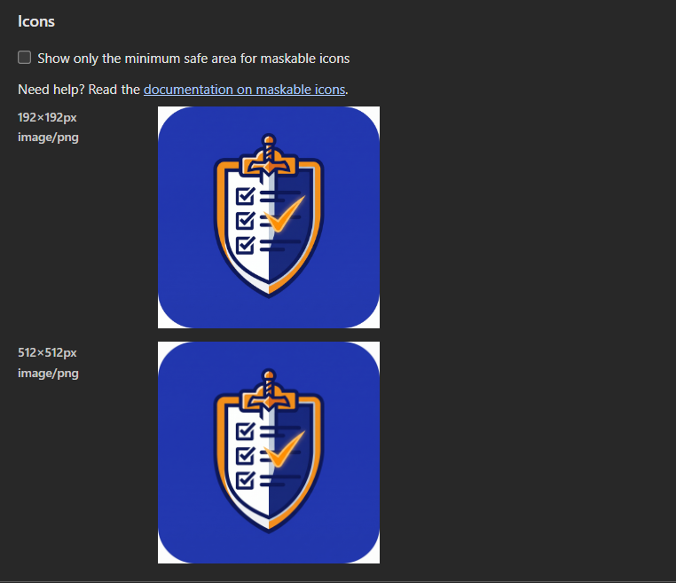
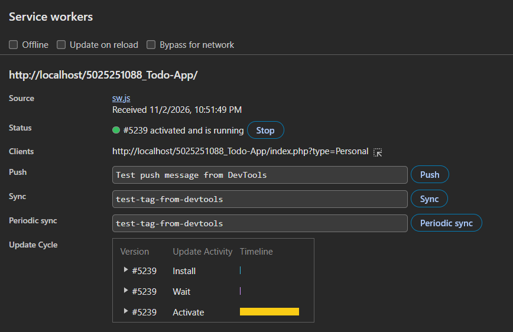
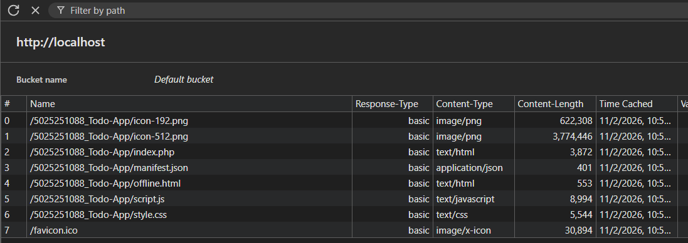
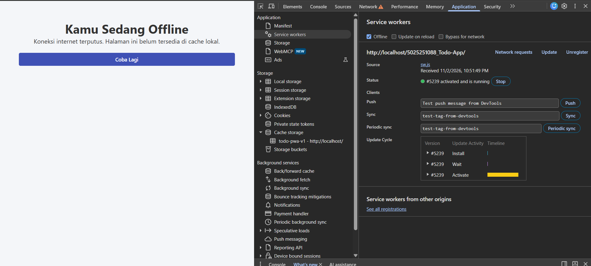
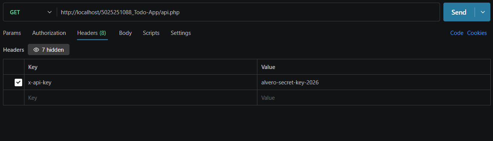
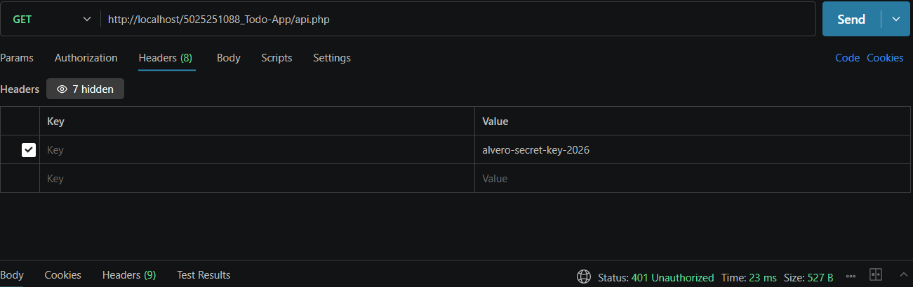

# 5025251088_Todo-App

**Identitas Diri**
* **Nama:** I Komang Bagus Alvero Wisnawa
* **NRP:** 5025251088
* **Mata Kuliah:** Pemrograman Web A

**Deskripsi Proyek**
Proyek ini merupakan antarmuka (UI) statis untuk aplikasi Todo Dashboard. Halaman ini dibangun menggunakan elemen semantik HTML5 dan CSS. Website ini dirancang menjadi responsif menggunakan kombinasi CSS Grid untuk struktur utama dan Flexbox untuk pembagian panel, sehingga tampilan tetap rapi baik pada layar desktop maupun mobile.

**Fitur Baru (E02a):** 
Menambahkan manipulasi DOM dengan JavaScript untuk fungsionalitas Todo App (tambah tugas, edit, hapus, tandai selesai, dan toggle Dark Mode).

**Fitur Baru (E03):** Menambahkan Web Storage (IndexedDB & localStorage), Media Capture untuk gambar, Service Worker untuk notifikasi pengingat, dan standar Aksesibilitas.

**Fitur Baru (E04):**
* Struktur PHP modular (`config.php`, `header.php`, `menu-bar.php`, `footer.php`, `process.php`, `index.php`).
* Navigasi menu bar terpisah untuk kategori Personal Todo dan Shared Todo.
* Integrasi database MySQL (`todo_app`) melalui file skema `data.sql`.
* Operasi CRUD (Create, Read, Update/Mark as Done, Delete) berbasis PHP.
* Fitur pengunggahan gambar (*File Handling*) yang tersimpan otomatis di folder `uploads`.

**Fitur Baru (E05 - The Offline Abyss):**
* Mengubah Todo App menjadi Progressive Web App (PWA) dengan `manifest.json` dan maskable icons.
* Menerapkan Service Worker (`sw.js`) untuk *precaching app shell* dan halaman offline fallback (`offline.html`).
* Menerapkan strategi *caching* (Network-First untuk halaman, Cache-First untuk aset statis).
* Menambahkan fungsionalitas instalasi PWA.

**Fitur Baru (E06 - The Endpoint of Portals):**
* Migrasi struktur backend menjadi RESTful API (`api.php`).
* Implementasi HTTP Methods: `GET` (Read), `POST` (Create), `PUT`/`PATCH` (Update), dan `DELETE` (Hapus).
* Implementasi Status Code HTTP yang sesuai (200 OK, 201 Created).
* Implementasi Error Status Code (400 Bad Request, 401 Unauthorized, 404 Not Found, 405 Method Not Allowed, 500 Server Error).
* Menambahkan Authentication API Key (`x-api-key`) pada headers untuk keamanan akses endpoint.

**Bukti Pengujian Offline (Cache Storage):**
**Bukti DevTools & Pengujian Offline:**

**Bukti Pengujian REST API (Postman):**

**Preview UI**
* **Dekstop:**
* 

* **Mobile:**
* 
* 

